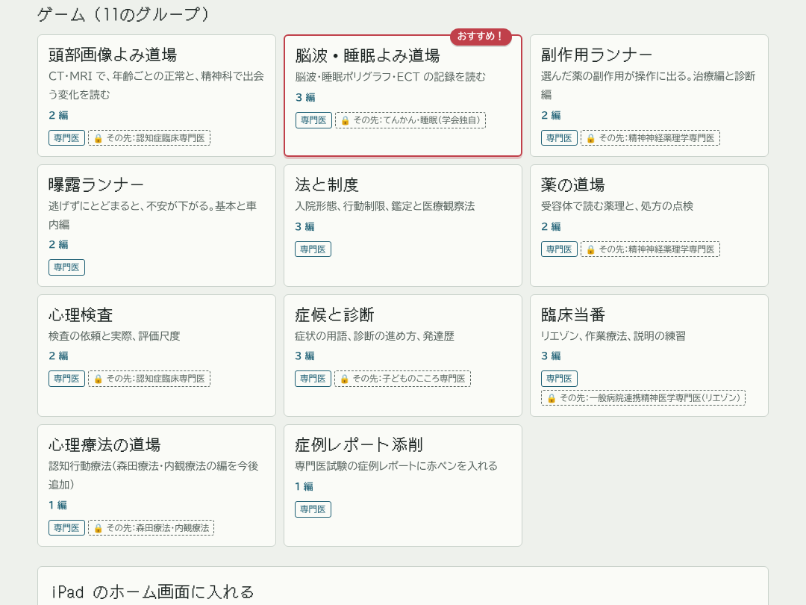
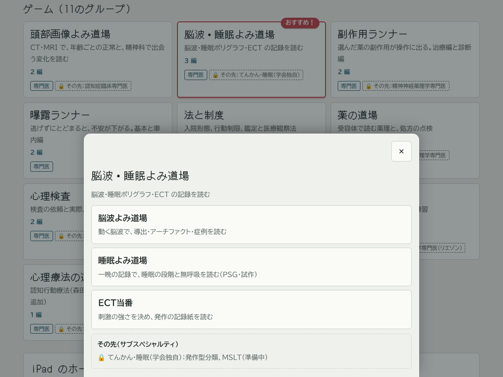
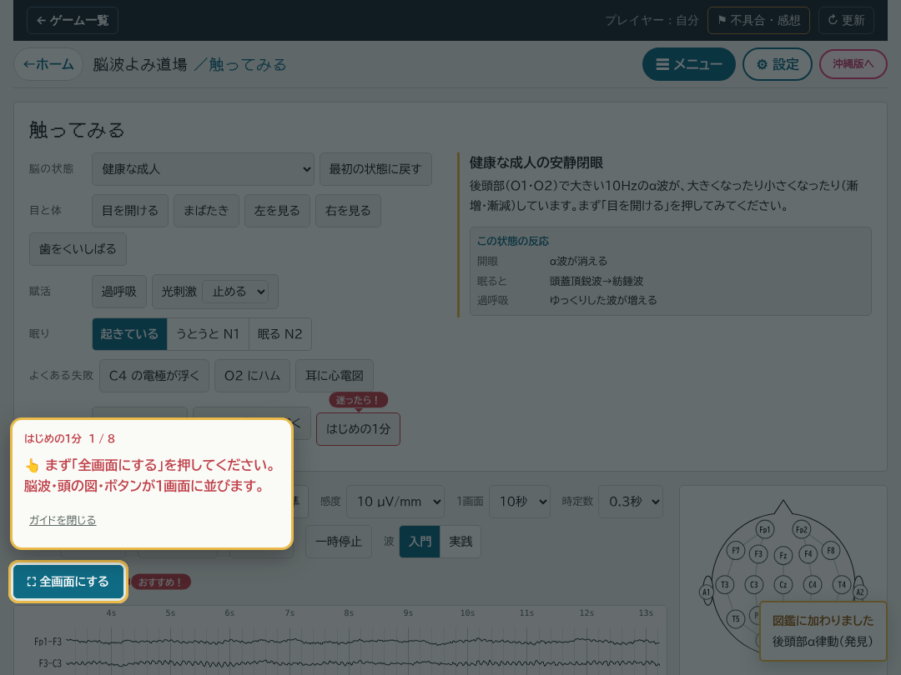

# 精神科道場（旧：精神科試験ゲーム）

精神科の専門医試験に向けて、脳波・画像・薬・法律・症状・心理療法を、動かして遊びながら覚えるウェブアプリです。iPad・スマホ・パソコンで使えます。

**▶ [iPad で遊ぶ（https://gng2482-collab.github.io/psycho-games/）](https://gng2482-collab.github.io/psycho-games/)**　Safari で開いて「ホーム画面に追加」すると、アプリのように使えます。

## 11 のグループ

| グループ | 中身 | その先（サブスペシャルティ） |
|---|---|---|
| 頭部画像よみ道場 | 頭部CTよみ道場・頭部MRIよみ道場 | 認知症臨床専門医 |
| 脳波・睡眠よみ道場 | 脳波よみ道場・睡眠よみ道場・ECT当番 | てんかん・睡眠（学会独自） |
| 副作用ランナー | 副作用ランナー・副作用ランナー 診断編 | 精神神経薬理学専門医 |
| 曝露ランナー | 曝露ランナー・曝露ランナー 車内編 | — |
| 法と制度 | 当直の入院判定・当直明けの病棟・書類の締め切り・病棟の一週間・外来の算定・鑑定と医療観察法 | — |
| 薬の道場 | 薬理ラボ・処方チェック | 精神神経薬理学専門医 |
| 心理検査 | 心理検査オーダー・評価尺度の道場 | 認知症臨床専門医 |
| 症候と診断 | 症候ハンター・診察クエスト・発達歴を読む | 子どものこころ専門医 |
| 臨床当番 | リエゾン当番・OT処方の日・説明の練習 | 一般病院連携精神医学専門医（リエゾン） |
| 心理療法の道場 | 認知行動療法の道場 | 森田療法・内観療法 |
| 症例レポート添削 | 症例レポート添削 | — |

※ 登場する患者・波形・画像の所見はすべて架空です。実際の診療は最新のガイドラインや添付文書で確かめてください。

このリポジトリはビルド成果物です。元は非公開リポジトリ psycoAI の `精神科試験ゲーム/作り方/build_ipad.py` で作っています。直接は編集しないでください。
